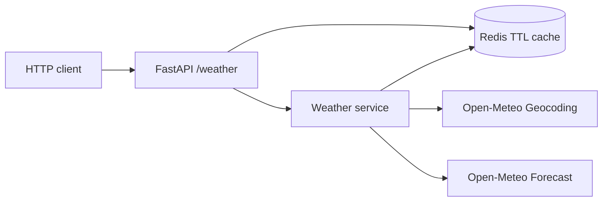

# Weather Cache API

[](https://github.com/RamonRDR/weather-cache-api/actions/workflows/ci.yml)

**Python 3.14 · FastAPI · Pydantic · httpx · Open-Meteo · Redis**

A small REST API that geocodes a city with Open-Meteo, retrieves current weather, and caches successful, validated responses in Redis with a configurable expiration time. This is a backend-focused international portfolio project.

> **Status:** Cycle 1. No production benchmark or measured speedup is claimed. Rate limiting, cache metrics, real Redis expiration tests, and reproducible benchmarks are planned for Cycle 2.

## Architecture



Cache hits avoid **both** upstream calls. The key is case-insensitive and whitespace-normalized. Redis failures do not interrupt upstream weather lookups. Only successful validated responses are cached.

## Quick start with Docker

```bash
docker compose up --build
curl 'http://localhost:8000/weather?city=Itajai'
```

Swagger UI: http://localhost:8000/docs

## Local development (Python 3.14)

```bash
python -m venv .venv
# Activate .venv in your shell
python -m pip install -e '.[dev]'
cp .env.example .env
docker compose up -d redis
uvicorn weather_cache_api.main:app --reload
```

Both local Docker ports bind to 127.0.0.1. The default app uses no API credentials.

## Configuration

| Environment variable | Default | Purpose |
| --- | --- | --- |
| REDIS_URL | redis://localhost:6379/0 | Redis connection |
| CACHE_TTL_SECONDS | 600 | TTL between 1 and 86,400 seconds |
| HTTP_TIMEOUT_SECONDS | 5 | Upstream timeout, max 60 seconds |

## Endpoint

```http
GET /weather?city=Itajai
```

Illustrative **mock test fixture**, not measured live weather:

```json
{
  "location": {"name": "Itajaí", "country": "Brazil", "latitude": -26.91, "longitude": -48.66},
  "current": {
    "observed_at": "2026-11-06T12:00:00Z",
    "temperature_c": 24.1,
    "apparent_temperature_c": 25.0,
    "relative_humidity_percent": 67,
    "precipitation_mm": 0.0,
    "weather_code": 2,
    "wind_speed_kmh": 12.4
  },
  "source": "open-meteo",
  "cached": false
}
```

A repeated request within TTL returns cached=true. 200: success; 404: city not found; 422: invalid city; 502: invalid upstream schema; 503: upstream HTTP/network error; 504: upstream timeout.

## Test and format

```bash
ruff check .
ruff format --check .
python -m pytest -q
```

All external HTTP responses use httpx.MockTransport; cache behavior uses a fake Redis client. The tests do not need internet or Redis. GitHub Actions runs lint, formatting, and tests on pull requests with Python 3.14.

## Intentional limitations

- When a name matches multiple locations, the first geocoding result is selected.
- Concurrent cache misses may duplicate upstream calls. No single-flight lock yet.
- Real Redis TTL expiration, metrics, rate limiting, and performance figures are not yet verified. They belong to Cycle 2.

## Design and attribution

Technical rationale: [Architecture decisions](docs/architecture.md).
Translations: [Português](README.pt-BR.md) · [Español](README.es.md).
Providers: [Open-Meteo Weather](https://open-meteo.com/en/docs) and [Open-Meteo Geocoding](https://open-meteo.com/en/docs/geocoding-api). Check [Open-Meteo terms](https://open-meteo.com/en/terms) before commercial use; credit the provider in public deployments.
Code: MIT License.
