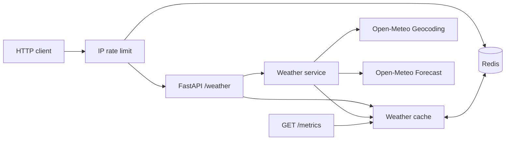

# Weather Cache API

[](https://github.com/RamonRDR/weather-cache-api/actions/workflows/ci.yml)

**Python 3.14 · FastAPI · Pydantic · httpx · Open-Meteo · Redis**

A small REST API that geocodes a city with Open-Meteo, retrieves current weather, and caches successful, validated responses in Redis with a configurable expiration time. This is a backend-focused international portfolio project.

> **Status:** Cycles 1 and 2 implemented on a review branch. This project does not claim production performance figures. Benchmark timings are measured with real Redis and **simulated** upstream latency.

## Architecture



Cache hits avoid **both** upstream calls. The key is case-insensitive and whitespace-normalized. Redis failures do not interrupt upstream weather lookups. Only successful validated responses are cached.

## Quick start with Docker

```bash
docker compose up --build
curl 'http://localhost:8000/weather?city=Itajai'
```

Swagger UI: http://localhost:8000/docs

## Local development (Python 3.14)

```bash
python -m venv .venv
# Activate .venv in your shell
python -m pip install -e '.[dev]'
cp .env.example .env
docker compose up -d redis
uvicorn weather_cache_api.main:app --reload
```

Both local Docker ports bind to 127.0.0.1. The default app uses no API credentials.

## Configuration

| Environment variable | Default | Purpose |
| --- | --- | --- |
| REDIS_URL | redis://localhost:6379/0 | Redis connection |
| CACHE_TTL_SECONDS | 600 | TTL between 1 and 86,400 seconds |
| HTTP_TIMEOUT_SECONDS | 5 | Upstream timeout, max 60 seconds |
| RATE_LIMIT_REQUESTS | 60 | Maximum requests per IP within a window |
| RATE_LIMIT_WINDOW_SECONDS | 60 | Fixed-window duration in seconds |

## Endpoint

```http
GET /weather?city=Itajai
```

Illustrative **mock test fixture**, not measured live weather:

```json
{
  "location": {"name": "Itajaí", "country": "Brazil", "latitude": -26.91, "longitude": -48.66},
  "current": {
    "observed_at": "2026-11-06T12:00:00Z",
    "temperature_c": 24.1,
    "apparent_temperature_c": 25.0,
    "relative_humidity_percent": 67,
    "precipitation_mm": 0.0,
    "weather_code": 2,
    "wind_speed_kmh": 12.4
  },
  "source": "open-meteo",
  "cached": false
}
```

A repeated request within TTL returns `cached=true`. 200: success; 404: city not found; 422: invalid city; 429: too many requests (includes `Retry-After`); 502: invalid upstream schema; 503: upstream HTTP/network error; 504: upstream timeout.

### Cache metrics and rate limiting

`GET /metrics` returns counters for **one running process**, which reset on restart and are **not aggregated** across workers. Example after one miss and one hit:

```json
{"cache_hits": 1, "cache_misses": 1, "cache_errors": 0, "hit_rate": 0.5}
```

`GET /weather` has a Redis-backed, atomic fixed-window limiter: 60 requests per 60 seconds per ASGI client IP by default. IPs are hashed in Redis keys, but this is not anonymization. Redis failures **fail open** (requests are allowed); therefore the limiter is best-effort, not a security boundary. Untrusted `X-Forwarded-For` headers are ignored. Behind a reverse proxy, explicitly configure a trusted proxy/IP strategy before production use.

## Test and format

```bash
ruff check .
ruff format --check .
python -m pytest -q
```

Unit tests mock HTTP and Redis. Integration tests use a real Redis instance to verify TTL expiry and rate-limit window reset. GitHub Actions starts Redis 7 and runs both sets on Python 3.14; no live weather API calls are needed.

```bash
docker compose up -d redis
RUN_REDIS_TESTS=1 REDIS_TEST_URL=redis://localhost:6379/15 python -m pytest -q
python scripts/benchmark.py --samples 30 --delay-ms 30
```

On Windows PowerShell, set environment variables with `$env:RUN_REDIS_TESTS='1'` and `$env:REDIS_TEST_URL='redis://localhost:6379/15'` before running pytest.

The benchmark executes `WeatherService` with real Redis and an `httpx.MockTransport` provider delayed by the requested number of milliseconds. Each cold sample deletes its unique cache entry; warm samples reuse a seeded entry. It prints observed mean/p50/p95 and median ratio at runtime. **These figures are environment-dependent, synthetic, and not live Open-Meteo or end-to-end HTTP timings.** No fixed speedup is claimed. See [measured CI benchmark results and methodology](docs/performance.md).

## Intentional limitations

- When a name matches multiple locations, the first geocoding result is selected.
- Concurrent cache misses may duplicate upstream calls. No single-flight lock yet.
- Metrics are per-process and not durable; `/metrics` is public and must be reviewed before exposure on the internet.
- Rate limiting fails open if Redis is unavailable and groups users by ASGI peer IP. Behind a reverse proxy, multiple end users may appear as one IP.
- The benchmark measures the service layer using a synthetic provider delay, not production traffic or end-to-end request latency.
- The Docker Compose stack is intended for local development only; no production deployment has been tested.

## Design and attribution

Technical rationale: [Architecture decisions](docs/architecture.md).
Translations: [Português](README.pt-BR.md) · [Español](README.es.md).
Providers: [Open-Meteo Weather](https://open-meteo.com/en/docs) and [Open-Meteo Geocoding](https://open-meteo.com/en/docs/geocoding-api). Check [Open-Meteo terms](https://open-meteo.com/en/terms) before commercial use; credit the provider in public deployments.
Code: MIT License.
