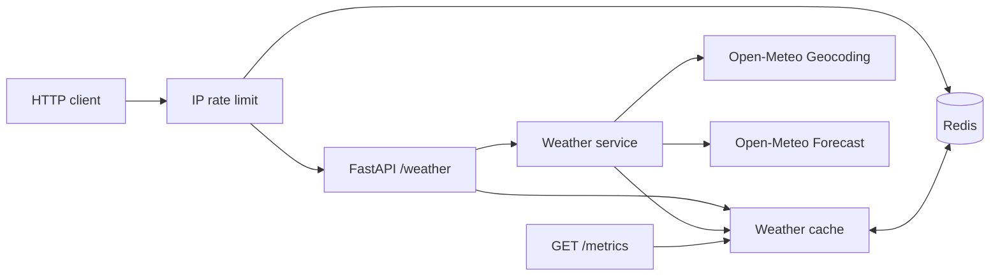

<div align="center">

# Weather Cache API 🌤️

**El tiempo a pedido. Caché inteligente. Desarrollado con Python y Redis.**

[🇺🇸 English](../../README.md) · [🇧🇷 Português](README.pt-BR.md) · [🇪🇸 Español](README.es.md)

[](https://github.com/RamonRDR/weather-cache-api/actions/workflows/ci.yml)
[](https://www.python.org/)
[](https://fastapi.tiangolo.com/)
[](https://redis.io/)
[](https://www.docker.com/)
[](https://github.com/RamonRDR/weather-cache-api/actions/workflows/ci.yml)
[](https://docs.astral.sh/ruff/)
[](../../LICENSE)

</div>

**Python 3.14 · FastAPI · Pydantic · httpx · Open-Meteo · Redis**

Una pequeña API REST que utiliza Open-Meteo para geocodificar una ciudad, consultar las condiciones meteorológicas actuales y almacenar respuestas válidas en Redis con un tiempo de expiración configurable. Es un proyecto de portafolio internacional centrado en el desarrollo backend.

> **Estado:** Los Ciclos 1 y 2 están integrados en la rama `main` protegida, después de la validación de CI y una revisión de Codex. El proyecto no afirma cifras de rendimiento en producción. Las latencias del benchmark se midieron con Redis real y un proveedor externo **simulado**.

## Arquitectura



Un acierto de caché evita **ambas** llamadas externas. La clave de caché no distingue mayúsculas de minúsculas y normaliza los espacios. Los fallos de Redis no interrumpen las consultas meteorológicas al proveedor. Solo se almacenan respuestas válidas y exitosas.

## Inicio rápido con Docker

```bash
docker compose up --build
curl 'http://localhost:8000/weather?city=Itajai'
```

Interfaz Swagger: http://localhost:8000/docs

## Desarrollo local (Python 3.14)

```bash
python -m venv .venv
# Activate .venv in your shell
python -m pip install -e '.[dev]'
cp .env.example .env
docker compose up -d redis
uvicorn weather_cache_api.main:app --reload
```

Los dos puertos locales de Docker se vinculan a 127.0.0.1. La aplicación predeterminada no utiliza credenciales de API.

## Configuración

| Variable de entorno | Valor predeterminado | Finalidad |
| --- | --- | --- |
| REDIS_URL | redis://localhost:6379/0 | Conexión con Redis |
| CACHE_TTL_SECONDS | 600 | TTL entre 1 y 86.400 segundos |
| HTTP_TIMEOUT_SECONDS | 5 | Tiempo de espera del proveedor, máximo 60 segundos |
| RATE_LIMIT_REQUESTS | 60 | Máximo de solicitudes por IP durante una ventana |
| RATE_LIMIT_WINDOW_SECONDS | 60 | Duración de la ventana fija en segundos |

## Endpoint

```http
GET /weather?city=Itajai
```

Ejemplo **ilustrativo de una prueba simulada**, no una medición meteorológica en tiempo real:

```json
{
  "location": {"name": "Itajaí", "country": "Brazil", "latitude": -26.91, "longitude": -48.66},
  "current": {
    "observed_at": "2026-11-06T12:00:00Z",
    "temperature_c": 24.1,
    "apparent_temperature_c": 25.0,
    "relative_humidity_percent": 67,
    "precipitation_mm": 0.0,
    "weather_code": 2,
    "wind_speed_kmh": 12.4
  },
  "source": "open-meteo",
  "cached": false
}
```

Una solicitud repetida dentro del TTL devuelve `cached=true`. Códigos HTTP: 200, éxito; 404, ciudad no encontrada; 422, ciudad inválida; 429, demasiadas solicitudes (incluye `Retry-After`); 502, esquema de respuesta externa inválido; 503, error HTTP/de red del proveedor; 504, tiempo de espera agotado por el proveedor.

### Métricas de caché y límites de solicitudes

`GET /metrics` devuelve contadores de **un solo proceso en ejecución**, que se reinician al reiniciar el proceso y **no se agregan** entre workers. Ejemplo después de un fallo y un acierto de caché:

```json
{"cache_hits": 1, "cache_misses": 1, "cache_errors": 0, "hit_rate": 0.5}
```

`GET /weather` cuenta con un limitador atómico de ventana fija respaldado por Redis: por defecto, 60 solicitudes cada 60 segundos por IP del cliente ASGI. Las IP se representan mediante hashes en las claves de Redis, pero esto no implica anonimización. Si Redis falla, el limitador **permite las solicitudes** (*fail-open*); por tanto, es una medida de mejor esfuerzo, no una barrera de seguridad. Se ignoran las cabeceras `X-Forwarded-For` no confiables. Detrás de un proxy inverso, configure explícitamente una estrategia de IP y proxies confiables antes de usarlo en producción.

## Pruebas y formato

```bash
ruff check .
ruff format --check .
python -m pytest -q
```

Las pruebas unitarias simulan HTTP y Redis. Las pruebas de integración utilizan Redis real para verificar el vencimiento del TTL y el restablecimiento del límite tras la ventana de tiempo. GitHub Actions inicia Redis 7 y ejecuta ambas con Python 3.14; no se necesitan consultas meteorológicas reales en esta etapa.

```bash
docker compose up -d redis
RUN_REDIS_TESTS=1 REDIS_TEST_URL=redis://localhost:6379/15 python -m pytest -q
python scripts/benchmark.py --samples 30 --delay-ms 30
```

En Windows PowerShell, configure las variables `$env:RUN_REDIS_TESTS='1'` y `$env:REDIS_TEST_URL='redis://localhost:6379/15'` antes de ejecutar pytest.

El benchmark ejecuta `WeatherService` con Redis real y un proveedor `httpx.MockTransport` que introduce el retraso solicitado en milisegundos. Cada muestra sin caché elimina su propia entrada; las muestras con caché reutilizan una entrada precargada. Se muestran la media, p50, p95 y la relación entre medianas observadas durante la ejecución. **Estos resultados dependen del entorno, son sintéticos y no representan latencias reales de Open-Meteo ni mediciones HTTP de extremo a extremo.** No se afirma una mejora fija de velocidad. Consulte [los resultados medidos en CI y la metodología](../performance.md).

## Prueba opcional con proveedor real (GitHub Actions)

El workflow independiente [Live Open-Meteo smoke test](../../.github/workflows/live-smoke.yml) se ejecuta cuando cambian archivos relevantes de un Pull Request y también admite ejecución manual mediante `workflow_dispatch` desde GitHub Actions. Construye e inicia la aplicación completa con Docker Compose, consulta **Berlín** en las APIs reales de geocodificación y meteorología de Open-Meteo, y comprueba que la segunda solicitud a `/weather` sea un acierto de caché Redis. Los resultados aparecen en los registros y el resumen del job.

Es un workflow **informativo**, no la comprobación obligatoria `quality`. Las interrupciones del proveedor o sus límites de solicitudes pueden provocar fallos sin bloquear el merge; investigue cualquier fallo antes de aprobar una versión. No se necesitan claves ni secretos de API. Para ejecutar la validación equivalente manualmente, con los contenedores iniciados, utilice `python scripts/smoke_live.py --city Berlin`.

## Limitaciones intencionadas

- Si un nombre coincide con varias ubicaciones, se selecciona el primer resultado de geocodificación.
- Los fallos simultáneos de caché pueden provocar llamadas externas duplicadas. Todavía no hay bloqueo *single-flight*.
- Las métricas son por proceso y no son persistentes; `/metrics` es público y debe revisarse antes de exponerlo en internet.
- El limitador permite solicitudes si Redis no está disponible y agrupa usuarios según la IP del par ASGI. Detrás de un proxy inverso, distintos usuarios pueden compartir la misma IP aparente.
- El benchmark mide la capa de servicio con retraso artificial del proveedor, no tráfico de producción ni latencia HTTP de extremo a extremo.
- La configuración Docker Compose está destinada al desarrollo local; no se ha probado ningún despliegue en producción.

## Decisiones técnicas y atribución

Justificación técnica: [Decisiones de arquitectura](../architecture.md).
Traducciones: [English](../../README.md) · [Português](README.pt-BR.md).
Proveedores: [Open-Meteo Weather](https://open-meteo.com/en/docs) y [Open-Meteo Geocoding](https://open-meteo.com/en/docs/geocoding-api). Consulte los [términos de Open-Meteo](https://open-meteo.com/en/terms) antes del uso comercial y atribuya el crédito correspondiente al proveedor en publicaciones públicas.
Código: [Licencia MIT](../../LICENSE).
