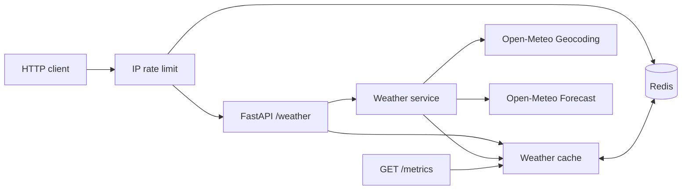

<div align="center">

# Weather Cache API 🌤️

**Clima sob demanda. Cache inteligente. Desenvolvido com Python e Redis.**

[🇺🇸 English](../../README.md) · [🇧🇷 Português](README.pt-BR.md) · [🇪🇸 Español](README.es.md)

[](https://github.com/RamonRDR/weather-cache-api/actions/workflows/ci.yml)
[](https://www.python.org/)
[](https://fastapi.tiangolo.com/)
[](https://redis.io/)
[](https://www.docker.com/)
[](https://github.com/RamonRDR/weather-cache-api/actions/workflows/ci.yml)
[](https://docs.astral.sh/ruff/)
[](../../LICENSE)

</div>

**Python 3.14 · FastAPI · Pydantic · httpx · Open-Meteo · Redis**

Uma pequena API REST que utiliza a Open-Meteo para localizar uma cidade por geocodificação, consultar as condições meteorológicas atuais e armazenar respostas válidas no Redis com prazo de expiração configurável. É um projeto de portfólio internacional com foco em desenvolvimento backend.

> **Status:** Os Ciclos 1 e 2 estão integrados à branch `main` protegida, após validação pelo CI e revisão do Codex. O projeto não apresenta números de desempenho em produção. As latências do benchmark foram medidas com Redis real e provedor externo **simulado**.

## Arquitetura



Quando há um acerto de cache, as **duas** chamadas externas são evitadas. A chave do cache não diferencia maiúsculas de minúsculas e normaliza espaços em branco. Falhas do Redis não interrompem as consultas meteorológicas ao provedor. Somente respostas bem-sucedidas e validadas são armazenadas.

## Início rápido com Docker

```bash
docker compose up --build
curl 'http://localhost:8000/weather?city=Itajai'
```

Interface Swagger: http://localhost:8000/docs

## Desenvolvimento local (Python 3.14)

```bash
python -m venv .venv
# Activate .venv in your shell
python -m pip install -e '.[dev]'
cp .env.example .env
docker compose up -d redis
uvicorn weather_cache_api.main:app --reload
```

As duas portas locais do Docker são vinculadas a 127.0.0.1. A aplicação padrão não utiliza credenciais de API.

## Configuração

| Variável de ambiente | Padrão | Finalidade |
| --- | --- | --- |
| REDIS_URL | redis://localhost:6379/0 | Conexão com Redis |
| CACHE_TTL_SECONDS | 600 | TTL entre 1 e 86.400 segundos |
| HTTP_TIMEOUT_SECONDS | 5 | Tempo limite do provedor, máximo de 60 segundos |
| RATE_LIMIT_REQUESTS | 60 | Número máximo de requisições por IP em uma janela |
| RATE_LIMIT_WINDOW_SECONDS | 60 | Duração da janela fixa em segundos |

## Endpoint

```http
GET /weather?city=Itajai
```

Exemplo **ilustrativo de teste simulado**, não uma medição meteorológica real:

```json
{
  "location": {"name": "Itajaí", "country": "Brazil", "latitude": -26.91, "longitude": -48.66},
  "current": {
    "observed_at": "2026-11-06T12:00:00Z",
    "temperature_c": 24.1,
    "apparent_temperature_c": 25.0,
    "relative_humidity_percent": 67,
    "precipitation_mm": 0.0,
    "weather_code": 2,
    "wind_speed_kmh": 12.4
  },
  "source": "open-meteo",
  "cached": false
}
```

Uma requisição repetida durante o TTL retorna `cached=true`. Códigos HTTP: 200, sucesso; 404, cidade não encontrada; 422, cidade inválida; 429, requisições em excesso (inclui `Retry-After`); 502, esquema de resposta externa inválido; 503, erro de rede/HTTP no provedor; 504, tempo limite excedido pelo provedor.

### Métricas do cache e limitação de requisições

`GET /metrics` retorna contadores de **um único processo em execução**, reiniciados junto com ele e **não agregados** entre workers. Exemplo após uma falha de cache e um acerto:

```json
{"cache_hits": 1, "cache_misses": 1, "cache_errors": 0, "hit_rate": 0.5}
```

`GET /weather` possui um limitador de janela fixa e atualização atômica com Redis: por padrão, 60 requisições a cada 60 segundos por IP do cliente ASGI. Os IPs são representados por hashes nas chaves do Redis, mas isso não constitui anonimização. Quando o Redis falha, o limitador **permite as requisições** (*fail-open*); portanto, é uma proteção de melhor esforço, não uma barreira de segurança. Cabeçalhos `X-Forwarded-For` não confiáveis são ignorados. Atrás de um proxy reverso, configure explicitamente uma estratégia de IPs e proxies confiáveis antes do uso em produção.

## Testes e formatação

```bash
ruff check .
ruff format --check .
python -m pytest -q
```

Os testes unitários simulam HTTP e Redis. Os testes de integração utilizam Redis real para verificar a expiração do TTL e a restauração do limite após a janela de tempo. O GitHub Actions inicia Redis 7 e executa ambos com Python 3.14; não são necessárias chamadas meteorológicas reais nessa etapa.

```bash
docker compose up -d redis
RUN_REDIS_TESTS=1 REDIS_TEST_URL=redis://localhost:6379/15 python -m pytest -q
python scripts/benchmark.py --samples 30 --delay-ms 30
```

No Windows PowerShell, configure as variáveis `$env:RUN_REDIS_TESTS='1'` e `$env:REDIS_TEST_URL='redis://localhost:6379/15'` antes de executar o pytest.

O benchmark executa `WeatherService` com Redis real e um provedor `httpx.MockTransport` que introduz o atraso configurado em milissegundos. Cada amostra sem cache remove sua própria entrada; as amostras com cache reutilizam uma entrada inicializada. Ele mostra média, p50, p95 e a razão entre medianas observadas durante a execução. **Esses resultados dependem do ambiente, são sintéticos e não representam latências reais da Open-Meteo nem medições HTTP de ponta a ponta.** Não é prometido um ganho fixo de velocidade. Consulte [os resultados medidos no CI e sua metodologia](../performance.md).

## Teste opcional com provedor real (GitHub Actions)

O workflow separado [Live Open-Meteo smoke test](../../.github/workflows/live-smoke.yml) é executado quando arquivos relevantes mudam em Pull Requests e também permite execução manual por `workflow_dispatch` no GitHub Actions. Ele constrói e inicia a solução completa com Docker Compose, consulta **Berlim** nas APIs reais de geocodificação e meteorologia da Open-Meteo e verifica se a segunda chamada a `/weather` é atendida pelo Redis. Os resultados aparecem nos logs e no resumo do job.

É um workflow **informativo**, não a verificação obrigatória `quality`. Indisponibilidade temporária ou limites de requisições do provedor podem causar falhas sem bloquear o merge; investigue qualquer erro antes de aprovar uma versão. Nenhuma chave ou segredo de API é necessário. Para realizar a validação equivalente manualmente, com os contêineres iniciados, execute `python scripts/smoke_live.py --city Berlin`.

## Limitações intencionais

- Quando um nome corresponde a várias localidades, a primeira opção da geocodificação é selecionada.
- Falhas simultâneas de cache podem causar chamadas externas duplicadas. Ainda não há bloqueio *single-flight*.
- As métricas são por processo e não são persistentes; `/metrics` é público e deve ser avaliado antes de exposição na internet.
- O limitador permite requisições quando o Redis fica indisponível e agrupa clientes pelo IP do par ASGI. Atrás de um proxy reverso, vários usuários podem aparecer com o mesmo IP.
- O benchmark mede a camada de serviço com atraso artificial no provedor, não tráfego de produção nem latência HTTP ponta a ponta.
- A solução com Docker Compose destina-se ao desenvolvimento local; não foi testado um deploy em produção.

## Decisões técnicas e atribuição

Justificativas técnicas: [Decisões de arquitetura](../architecture.md).
Traduções: [English](../../README.md) · [Español](README.es.md).
Provedores: [Open-Meteo Weather](https://open-meteo.com/en/docs) e [Open-Meteo Geocoding](https://open-meteo.com/en/docs/geocoding-api). Consulte os [termos da Open-Meteo](https://open-meteo.com/en/terms) antes de uso comercial e atribua os devidos créditos ao provedor em publicações públicas.
Código: [Licença MIT](../../LICENSE).
